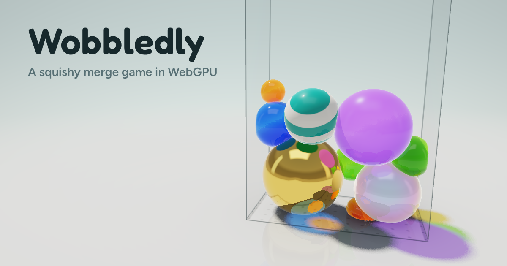

# Wobbledly

A squishy merge game that runs in the browser on WebGPU.

**Play it:** https://wobbledly.netlify.app



## How to play

- Drag to aim, let go to drop a blob.
- Two blobs of the same size fuse into the next size up.
- Each level has a goal blob. Make it before the pile sits over the dashed line.
- Later levels give you less room and add grey duds, which never merge and only clear when a merge happens right beside them.
- Levels 9 to 16 each add a twist: a peg that splits the tank, a bumper sweeping the drop zone, a limit of 33 drops, two goal blobs that must stay apart, moon gravity, shifting wind, and quakes that shake the pile.
- **Sandbox** switches to free play: six materials, five shapes, gravity flips, slow motion and a Boom button.

## Requirements

A browser with WebGPU: current Chrome or Edge (desktop, or Android 12 and newer) or Safari 26 and newer.

## How it works

Everything lives in one file, `index.html`, with no build step and no dependencies.

- **Physics** runs in WebGPU compute shaders. Each blob is a closed mesh of about 600 particles held together by shape matching, with neighbour smoothing for ripples and an internal pressure term so squashed blobs bulge.
- **Collisions** push particles out of the other blobs' deformed signed-distance shapes, so two soft blobs meet at a shared contact surface.
- **Rendering** is WebGPU too: shadow-mapped light with coloured shadows through translucent jelly, floor reflections, and proxy-sphere reflections in chrome.
- **Music and sound** are generated live with the Web Audio API.

## Run it locally

Serve the folder with any static file server and open it in a WebGPU browser:

```
npx serve .
```

## License

MIT. See [LICENSE](LICENSE).

Brought to you by [Stooplight](https://stooplight.com). Vibe coded with Claude.
